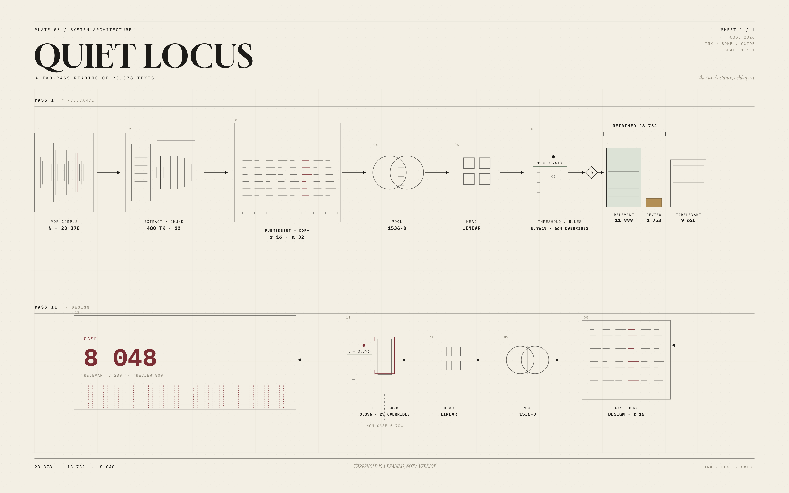

# PubMedBERT 遗传变异病例筛选

产前遗传变异**病例报告 / 病例系列**相关性筛查。输出三档：`relevant` / `review` / `irrelevant`。

**默认最优解**：公平分块 **DoRA** + 金标重校准阈值 + **规则层**（`artifacts/best/`）。

| 组件 | 设定 |
|------|------|
| 编码器 | NeuML `pubmedbert-base-embeddings`，块长 480、最多 12 块，保留前 2 块 |
| 文档特征 | `L2(mean_all) ‖ L2(mean_first_2)` → **1536-d** |
| 适配器 | DoRA（r=16, α=32，`query`/`value`）+ 线性分类头 |
| 阈值 | **0.7619**（金标 49 篇上 R≥0.95 重校准） |
| 规则层 | 硬排除 NIPT/大规模筛查、综述/指南、GWAS/数据库等；病例线索保护 |
| 决策 | `score ≥ t` → relevant；`t−0.15 ≤ score < t` → review；否则 irrelevant；规则可强制排除或降为 review |

另有 **case-only 二阶段模型**（`artifacts/case_dora/`）：在 864 篇 `design` 标签上以同一分块 DoRA 架构判别 `case report / case series`，5 折 test AP **0.987 ± 0.009**、F1 **0.938 ± 0.021**；全量 23,378 篇筛选后保留 13,752，case-only **8,048**。已发布到 Hugging Face：[`lanshi/prenatal-case-dora`](https://huggingface.co/lanshi/prenatal-case-dora)。详见 §3.6 / §4.3。

旧方案 frozen PubMedBERT + LR：`artifacts/model.joblib`（`--legacy-lr`）。SPECTER2 已弃用（`artifacts/archive_specter2/`）。

---

## 1. 目录

```text
src/
  encoder.py                 # 分块编码 / 池化（冻结 PubMedBERT）
  rule_layer.py              # 困难负样本规则层
  predict.py                 # 推理：默认 DoRA+rules，--legacy-lr 走旧基线
  case_model.py              # case-only DoRA 推理封装（case report / case series）
  api.py                     # FastAPI 服务
  mcp_server.py              # MCP 入口（stdio / sse / streamable-http）
  train.py                   # frozen + LR 基线训练
  build_dataset.py           # data/labeled_papers.csv 构建
  scripts/
    finetune_chunk_fair.py   # 公平分块微调 Full / DoRA / GaLore（★ 最优解训练器）
    ablation_abcd.py         # 消融 A/B/C/D
    eval_rule_layer.py       # 规则层评测
    gold_review.py           # 金标审核（Web / 终端）
    export_dora_review.py    # 导出 DoRA 分数与 FN/FP 复核队列
    screen_corpus.py         # 全量 PDF 语料筛选（23k → 三档结果 + 汇总，可断点续跑）
    filter_case_type.py      # 仅保留 case report / case series（标题级快速分类器）
    finetune_case_dora.py    # case-only DoRA 训练（design 标签，5 折 CV + 最终模型）
    case_baselines.py        # 5 折基准/消融（TF-IDF、冻结 PubMedBERT、输入/池化）
    score_case_corpus.py     # 用 case-only DoRA 对保留集推理，输出最终 case 集合
    push_to_hf.py            # 上传 case-only 模型包到 Hugging Face Hub
    ahp_label/               # 多模型 AHP 弱标流水线
    <历史基线脚本>            # compare_* / retrain_* / eval_hardening / error_audit 等
docs/
  ARCHITECTURE.md            # 整体架构、算法设计、数据结构、目录结构
  briefs/                    # 任务书、评审规格、实验与复盘记录
data/                        # 标签、语料、全文包（大文件已 gitignore）
artifacts/                   # 模型权重、阈值、评测产物（脚本写出，勿手工编辑）
```

> 旧代 `pubmedbert/`（独立打包的 `casefilter` 子项目：规则层 + 现成 head_v3 权重）已移除，
> 本仓库只保留最终代 **DoRA + 规则层**。源码存档在 git tag `archive/pre-dora-legacy`：
> `git checkout archive/pre-dora-legacy -- pubmedbert`

代码根 `src/` 不是包：模块之间按扁平名互相 import（`from encoder import ...`），脚本用
`ROOT = Path(__file__).resolve().parents[2]` 定位仓库根，并把 `ROOT/"src"` 加入 `sys.path`。
因此**所有命令都在仓库根目录执行**。也可 `export PYTHONPATH=src` 后直接 `python -c "import train"`。

---

## 2. 环境

```bash
uv venv --python 3.12 .venv
uv pip install --python .venv/bin/python -r requirements.txt
# GPU 版 torch 按本机 CUDA 安装；另需 peft / accelerate / galore-torch（见 requirements）
```

可选本地快照：

```bash
export PUBMEDBERT_MODEL_PATH=/path/to/NeuML/pubmedbert-base-embeddings/snapshot
```

---

## 3. 预测 / API（默认最优解）

```bash
# 单条 / 抽样
.venv/bin/python src/predict.py --best --sample 1
.venv/bin/python src/predict.py --best --pdf paper.pdf --title "Prenatal case report"

# 关闭规则
.venv/bin/python src/predict.py --best --no-rules --sample 1

# 旧 frozen+LR
.venv/bin/python src/predict.py --legacy-lr --sample 1

# API（默认 MODEL_BACKEND=best）
MODEL_BACKEND=best USE_RULES=1 \
  .venv/bin/uvicorn --app-dir src api:app --host 0.0.0.0 --port 8000 --workers 1

# MCP（默认 stdio；Cursor 见 .cursor/mcp.json）
MODEL_BACKEND=best USE_RULES=1 .venv/bin/python src/mcp_server.py
# 可选 HTTP：.venv/bin/python src/mcp_server.py --transport streamable-http --port 8765
```

MCP 工具：`get_screener_info` / `screen_paper` / `screen_pdf` / `screen_batch`。说明见 [`artifacts/best/BEST.md`](artifacts/best/BEST.md)，架构与算法见 [`docs/ARCHITECTURE.md`](docs/ARCHITECTURE.md)。

### 3.1 最佳模型用法示例（逐条可跑）

以下输出为本机实跑（`device=cuda`，`thr=0.7619`），可直接对照。

**① 只给标题 + 摘要（一条）**

```bash
.venv/bin/python src/predict.py --best \
  --title "Prenatal diagnosis of a 22q11.2 deletion in a fetus with tetralogy of Fallot" \
  --abstract "A 28-year-old gravida 2 woman whose fetus showed tetralogy of Fallot and increased nuchal translucency at 13 weeks. Amniocentesis was performed; chromosomal microarray revealed a 2.5 Mb deletion at 22q11.2."
```

```jsonc
{
  "doc_id": null,
  "title": "Prenatal diagnosis of a 22q11.2 deletion in a fetus with tetralogy of Fallot",
  "decision": "relevant",
  "model_decision": "relevant",
  "relevance_score": 0.948522,
  "threshold": 0.7619361281394958,
  "review_threshold": 0.611936,
  "full_text_available": false,
  "pdf_used": false,
  "feature_mode": "dora_chunk_1536",
  "encoder_family": "pubmedbert_dora",
  "backend": "dora_chunk",
  "rules_enabled": true,
  "rules_fired": [],
  "rules_overridden": false,
  "rules_protected_by_case": true      // 命中病例线索保护（不改变结论，只阻止误排除）
}
```

**② 给全文 PDF（推荐，召回明显更高）**

```bash
.venv/bin/python src/predict.py --best --pdf paper.pdf --title "Prenatal case report"
```

摘要常省略用了哪种检测；有全文时 `full_text_available=true`，DoRA 能在 Methods/Results 里找到检测与表型证据。消融 B 显示全文对召回/AP 有明显提升，**生产环境请传全文**。

**③ 批量：CSV / TSV / JSON**

```bash
# 输入列：doc_id(pmid), title, abstract，可选 text / pdf_path / design
.venv/bin/python src/predict.py --best --input papers.csv --output out/pred.json
```

输出形态：**多条 → JSON 数组；结果只剩一条时折叠为单个对象**（`--limit 1` 也如此），下游解析请兼容两种。JSON 输入支持对象数组或 `{"records": [...]}`。也可用 `--json '<单条 JSON>'` 直接喂一条：

```bash
.venv/bin/python src/predict.py --best \
  --json '{"doc_id":"x1","title":"Fetal ultrasound anomaly cohort","abstract":"Retrospective cohort of 120 fetuses with increased nuchal translucency; whole exome sequencing performed."}' \
  --no-json-lines
```

这条是**规则层生效的典型**：模型给 `0.95116`（判 `relevant`），但命中 `LARGE_PRENATAL_COHORT`（大规模产前筛查队列，非单病例报告），最终：

```jsonc
{
  "decision": "irrelevant",          // 规则强制改判
  "model_decision": "relevant",      // 模型原始判断
  "relevance_score": 0.95116,
  "rules_fired": ["LARGE_PRENATAL_COHORT"],
  "rules_overridden": true
}
```

`decision` 与 `model_decision` 不一致 = 规则层改判了，用 `rules_fired` 查原因。

**④ Python 调用（集成到自己的流程）**

```python
import sys
sys.path.insert(0, "src")          # 在仓库根目录执行
from predict import load_predictor

predictor = load_predictor(best=True, use_rules=True)   # device 默认 cuda→cpu
print(predictor.backend, predictor.threshold)           # dora_chunk 0.7619361281394958

out = predictor.predict_record({
    "doc_id": "demo-1",
    "title": "Prenatal diagnosis of a 22q11.2 deletion in a fetus with tetralogy of Fallot",
    "abstract": "…chromosomal microarray revealed a 2.5 Mb deletion at 22q11.2.",
    # "text": "...",          # 可选：全文
    # "pdf_path": "paper.pdf",  # 可选：自动抽文本（相对路径以仓库根为基准）
})
print(out["decision"], out["relevance_score"], out["rules_fired"])
```

常用方法：

| 方法 | 输入 | 返回 |
|---|---|---|
| `predict_record(dict)` | `doc_id` / `title` / `abstract` / `text` / `pdf_path` / `design` 任一组合 | 单条结果 dict |
| `predict_pdf(path, title="", abstract="")` | PDF 路径 | 单条结果 dict（自动抽全文） |
| `predict_input_file(path, limit=None)` | `.json` / `.csv` / `.tsv` | 结果 dict 列表 |

**⑤ 决策规则（读输出时的关键）**

```text
score ≥ t (0.7619)                 → relevant
t − 0.15 (0.6119) ≤ score < t      → review
score < t − 0.15                   → irrelevant
之后规则层可强制 irrelevant，或把 relevant 降为 review（病例线索可保护，见 rules_protected_by_case）
```

评分口径：`relevant` 与 `review` 都算"召回保留"，只有 `irrelevant` 是漏检。下游只想要高置信集合 → 取 `decision == "relevant"`；要保召回 → 取 `decision != "irrelevant"`，再把 `review` 送人工。

**⑥ 常用开关**

```text
--no-rules         # 关闭规则层，只看模型原始分（对比 / 调试）
--device cpu       # 强制 CPU（无 GPU 或显存不足）
--sample 5         # 从 data/labeled_papers.csv 抽前 5 条，冒烟测试
--limit 100        # 配合 --input，只跑前 N 条
--output out.json  # 结果落盘（批量建议必带）
```

> **前提**：`artifacts/finetune_fair/dora/checkpoint/model.pt`（约 440 MB，gitignore，需训练或另行获取）、`artifacts/best/config.json` 与阈值文件，以及编码器快照 `NeuML/pubmedbert-base-embeddings`（可用 `PUBMEDBERT_MODEL_PATH` 指向本地快照）。
>
> **耗时参考**（本机 RTX 4060 + cuda）：进程启动+加载约 4 s（三次实测 3.6–4.6 s，含 CUDA 初始化），之后单条标题摘要推理约 6 ms；有全文时按块数线性增长（≤12 块）。CPU 会明显更慢，建议 `--device cpu` 仅用于调试。

### 3.2 HTTP API 调用示例

API 只有 3 个路由：`GET /`、`GET /health`、`POST /predict`。交互式文档在 `/docs`。

**① 启动**

```bash
MODEL_BACKEND=best USE_RULES=1 \
  .venv/bin/uvicorn --app-dir src api:app --host 127.0.0.1 --port 8000 --workers 1
```

必须 `--app-dir src`；必须**单 worker**（模型常驻显存，多 worker 会重复加载）。进程起来后 `/health` 返回 `model_loaded:true` 才算就绪 —— 模型是懒加载的，别用端口通不通判断。

```bash
curl -s http://127.0.0.1:8000/health | python3 -m json.tool
```

```jsonc
{
  "status": "ok",
  "model_loaded": true,
  "backend": "dora_chunk",
  "threshold": 0.7619361281394958,
  "review_threshold": 0.6119361281394958,
  "feature_mode": "dora_chunk_1536",
  "device": "cuda",
  "rules_enabled": true,
  "encoder_family": "pubmedbert_dora",
  "model_path_encoder": "NeuML/pubmedbert-base-embeddings",
  "max_chunks": 12
}
```

**② `POST /predict`（JSON）**

```bash
curl -s -X POST http://127.0.0.1:8000/predict \
  -H 'Content-Type: application/json' \
  -d '{
    "pmid": "11175621",
    "title": "Nuchal translucency: an ultrasound marker for fetal chromosomal abnormalities.",
    "abstract": "Increased nuchal translucency is associated with fetal chromosomal abnormalities."
  }'
```

```jsonc
{
  "doc_id": "11175621",      // 由 pmid 回填
  "title": "Nuchal translucency: an ultrasound marker for fetal chromosomal abnormalities.",
  "decision": "relevant",
  "model_decision": "relevant",
  "relevance_score": 0.949265,
  "threshold": 0.7619361281394958,
  "review_threshold": 0.611936,
  "full_text_available": false,
  "pdf_used": false,
  "feature_mode": "dora_chunk_1536",
  "encoder_family": "pubmedbert_dora",
  "backend": "dora_chunk",
  "rules_enabled": true,
  "rules_fired": [],
  "rules_overridden": false,
  "rules_protected_by_case": false
}
```

JSON body 接受字段：`title` / `abstract` / `text` / `year` / `pmid` / `doc_id` / `pdf_base64`（其余字段被忽略，不会报错）。

**③ `POST /predict`（multipart，传 PDF）**

```bash
curl -s -X POST http://127.0.0.1:8000/predict \
  -F 'title=Prenatal case report' \
  -F 'pdf=@paper.pdf'
```

表单字段：`title` / `abstract` / `text` / `year` / `pmid` / `doc_id` + 文件 `pdf`（或 `file`）。服务端用 PyMuPDF 抽文本后自动置 `pdf_used=true`；PDF 上限 **30 MB**（`MAX_PDF_BYTES` 可调），超了返回 413。JSON 里也可用 `pdf_base64` 传同样的文件。

**④ Python 客户端**

```python
import requests

r = requests.post("http://127.0.0.1:8000/predict", json={
    "pmid": "11175621",
    "title": "Nuchal translucency: an ultrasound marker for fetal chromosomal abnormalities.",
    "abstract": "Increased nuchal translucency is associated with fetal chromosomal abnormalities.",
}, timeout=60)
r.raise_for_status()
out = r.json()
print(out["decision"], out["relevance_score"])
```

批量就是循环调用；服务端无批接口，别开并发压同一个单 worker 进程（推理是同步的，多线程只会排队）。

**⑤ 错误码**

| 码 | 场景 | 响应 |
|---|---|---|
| `400` | JSON 解析失败 / `pdf_base64` 非法 / PDF 抽不出文本 | `{"detail": "invalid JSON: ..."}` 等 |
| `413` | PDF 超过 `MAX_PDF_BYTES` | `{"detail": "PDF too large"}` |
| `422` | `title`/`abstract`/`text` 全空且无 PDF | `{"detail": "provide title/abstract/text, ..."}` |
| `503` | 模型未加载（启动失败） | `{"detail": "model not loaded"}`，先查 `/health` 的 `error` |

**⑥ 就绪探针（写进启动脚本）**

```bash
until curl -sf http://127.0.0.1:8000/health | grep -q '"status":"ok"'; do sleep 1; done
```

**⑦ 环境变量**

| 变量 | 默认 | 说明 |
|---|---|---|
| `MODEL_BACKEND` | `best` | `best`/`dora` → DoRA；其他 → 旧 frozen+LR |
| `USE_RULES` | `1` | `0`/`false`/`no`/`off` 关闭规则层 |
| `DEVICE` | 自动 | `cuda` / `cpu` |
| `MAX_PDF_BYTES` | `31457280` | PDF 上限（字节） |
| `PORT` | `8000` | 仅 `python src/api.py` 直启时生效 |

> ⚠️ 默认**无鉴权、无 CORS**，不要直接暴露公网；需要时在前面加反向代理或自行挂 `Depends`。

### 3.3 MCP 调用示例

MCP 面向 Agent（Cursor / Claude Desktop 等）。四个工具：`get_screener_info` / `screen_paper` / `screen_pdf` / `screen_batch`。

**① stdio（推荐，Cursor 已配好）**

仓库自带 `.cursor/mcp.json`，重启 Cursor 后即可用，无需手动启动：

```jsonc
{
  "mcpServers": {
    "fetal-case-screener": {
      "type": "stdio",
      "command": "${workspaceFolder}/.venv/bin/python",
      "args": ["${workspaceFolder}/src/mcp_server.py"],
      "env": { "MODEL_BACKEND": "best", "USE_RULES": "1" }
    }
  }
}
```

其他客户端（Claude Desktop 等）把 `command`/`args` 换成同一份绝对路径即可。

**② HTTP 传输（给远程 / 容器内的 Agent）**

```bash
MODEL_BACKEND=best USE_RULES=1 \
  .venv/bin/python src/mcp_server.py --transport streamable-http --host 127.0.0.1 --port 8765 --preload
# 端点：POST http://127.0.0.1:8765/mcp
# 旧协议：--transport sse（同 host/port，端点 /sse）
```

`--preload` 在开始接收流量前加载模型（否则首个调用会等约 4 s）。HTTP 端点要带 `Accept: application/json, text/event-stream` 并按 MCP 握手流程走，**不适合直接 curl 调试**，用 MCP 客户端。

> ⚠️ **端口冲突**：MCP 默认 `8765`，正好和 `src/scripts/gold_review.py`（金标审核 UI，默认也是 8765）撞车。两者同时跑会 `Address already in use`，换一个 `--port` 即可。

**③ 工具入参（⚠️ 必须包一层 `params`）**

四个工具里除 `get_screener_info` 无参外，其余三个的 JSON-RPC 参数都要求 `{"params": {...}}`，直接平铺字段会报 `Field required` 校验错：

| 工具 | `params` 内容 |
|---|---|
| `get_screener_info` | 无（传 `{}`） |
| `screen_paper` | `title` / `abstract` / `text` / `pmid` / `design` / `use_rules`（均可选） |
| `screen_pdf` | `pdf_path`（必填）+ `title` / `abstract` / `use_rules` |
| `screen_batch` | `papers`（1–20 条，每条 `title`/`abstract`/`text`/`pmid`/`design`）+ `use_rules` |

`use_rules` 传 `true`/`false` 可**单次调用**覆盖环境变量；`design` 是给规则层的体裁提示（如 `review`、`NIPT`）。`screen_batch` 上限硬限制 20 条。

**④ Python 客户端实调**

```python
import asyncio, os
from mcp import ClientSession, StdioServerParameters
from mcp.client.stdio import stdio_client

ROOT = "/abs/path/to/this/repo"

async def main():
    p = StdioServerParameters(
        command=f"{ROOT}/.venv/bin/python",
        args=[f"{ROOT}/src/mcp_server.py"],
        env={**os.environ, "MODEL_BACKEND": "best", "USE_RULES": "1"},
    )
    async with stdio_client(p) as (r, w):
        async with ClientSession(r, w) as s:
            await s.initialize()
            print([t.name for t in (await s.list_tools()).tools])

            res = await s.call_tool("screen_paper", {"params": {
                "pmid": "11175621",
                "title": "Nuchal translucency: an ultrasound marker for fetal chromosomal abnormalities.",
                "abstract": "Increased nuchal translucency is associated with fetal chromosomal abnormalities.",
            }})
            print(res.content[0].text)      # 就是 predict_record 的 JSON

asyncio.run(main())
```

实跑结果（与 API 同一条输入，分数一致）：

```jsonc
{
  "decision": "relevant",
  "model_decision": "relevant",
  "relevance_score": 0.949265,
  "rules_fired": [],
  "rules_overridden": false
}
```

**⑤ 批量**

```python
res = await s.call_tool("screen_batch", {"params": {"papers": [
    {"pmid": "b1", "title": "Prenatal diagnosis of trisomy 21 in a fetus",
     "abstract": "amniocentesis karyotyping confirmed trisomy 21."},
    {"pmid": "b2", "title": "Fetal ultrasound anomaly cohort",
     "abstract": "Retrospective cohort of 120 fetuses with increased nuchal translucency; whole exome sequencing performed."},
]}})
```

返回是**带外层包装的对象**，不是裸数组（与 CLI `--input` 不同）：

```jsonc
{
  "count": 2,
  "results": [
    { "doc_id": "b1", "decision": "relevant", "relevance_score": 0.946756, ... },
    { "doc_id": "b2", "decision": "irrelevant", "model_decision": "relevant",
      "rules_fired": ["LARGE_PRENATAL_COHORT"], ... }
  ]
}
```

**⑥ 错误与校验行为**

分两类，客户端处理方式不同：

- **业务错误 → `is_error=false`**，正文是 `{"error": ...}` JSON：
  - `title`/`abstract`/`text` 全空 → `{"error": "provide at least one of title, abstract, or text", "hint": ...}`
  - 模型加载失败 → `{"error": "model not loaded: ..."}`，先调 `get_screener_info` 看 `status`
- **入参校验失败 → `is_error=true`**，正文是纯文本 `Error executing tool screen_paper: 1 validation error ...`（**不是** JSON，直接 `json.loads` 会炸）。触发条件：
  - 字段平铺未包 `params` → `params: Field required`
  - 拼错/未声明字段 → `Extra inputs are not permitted`（`extra="forbid"`，防静默丢参）
  - `screen_batch` 的 `papers` 超过 20 条 → 长度约束失败

**⑦ 环境变量**

`MODEL_BACKEND` / `USE_RULES` / `DEVICE` / `MODEL_PATH`，以及 `MCP_TRANSPORT`（`stdio`/`sse`/`streamable-http`）、`MCP_HOST`、`MCP_PORT` —— 均可用命令行参数覆盖，命令行优先。

### 3.4 全量语料筛选（23k PDF）

`src/scripts/screen_corpus.py` 直接读取 AutomatedPubMed 下载索引与 PDF 全量，逐篇抽全文 →
DoRA 打分 → 规则层，按 PMID 输出三档结果。PDF 抽取放在隔离子进程（MuPDF 遇到坏文件可能
段错误），单篇崩溃/超时只会记 `extract_error` 并继续；结果逐批落盘，可断点续跑。

```bash
# 冒烟 50 篇
.venv/bin/python src/scripts/screen_corpus.py --limit 50 --out-dir artifacts/screen_smoke

# 全量（默认索引/PDF 目录见脚本常量；中断后原命令重跑即续）
.venv/bin/python src/scripts/screen_corpus.py --out-dir artifacts/screen_full

# 分片/分段跑（--resume 默认开启，已完成的 PMID 自动跳过）
.venv/bin/python src/scripts/screen_corpus.py --start 0 --limit 6000
```

产物在 `--out-dir`：`results.jsonl`/`results.csv`（全量，含分数、规则命中、抽取状态）、
`relevant.csv`/`review.csv`/`irrelevant.csv`、`summary.json`、`REPORT.md`。
PDF 无文本（扫描件/抽取失败）仍会用标题打分，并在 `full_text_available` / `ocr_needed` /
`extract_error` 中标记，不静默丢弃。

### 3.5 仅保留 case 类（case report / case series）

相关性模型判断主题匹配，队列研究也可能高分；这里再做一层研究设计过滤。两种方式：

1. **标题级快速分类**：`filter_case_type.py`，TF-IDF + 逻辑回归，仅用标题，秒级完成；
2. **case-only DoRA（推荐）**：`finetune_case_dora.py` 用同一分块/池化架构在 `design` 标签上
   微调，再用 `score_case_corpus.py` 对保留集推理。全文输入，5 折 test AP 0.987 ± 0.009、
   F1 0.938 ± 0.021，优于标题级分类器（详见 3.6）。

```bash
.venv/bin/python src/scripts/filter_case_type.py            # 默认阈值 0.5
.venv/bin/python src/scripts/filter_case_type.py --threshold 0.6
```

产物（`artifacts/screen_full/`）：`case_retained.csv`（relevant+review 中的 case 类）、
`case_relevant.csv`、`case_review.csv`、`results_with_design.csv`（全量 + `design_score`）、
`case_summary.json`、`CASE_ONLY.md`。5 折交叉验证 AUC 0.964，阈值 0.5 时 P 0.936 / R 0.859。

### 3.6 case-only DoRA 训练与推理

目标：`design ∈ {case report, case series}` 为正类，cohort / screening / review / method /
validation / registry 为负类；缺失或 `other` 不参与训练（864 篇，376 正 / 488 负）。
架构与相关性模型一致：PubMedBERT + DoRA(r=16, α=32)、480 token × 12 块、1536-d 池化特征。

```bash
# 5 折 CV（每折独立训练，结果写 artifacts/case_dora/cv/；可按折分段跑）
.venv/bin/python src/scripts/finetune_case_dora.py --folds 0,1
.venv/bin/python src/scripts/finetune_case_dora.py --folds 2,3
.venv/bin/python src/scripts/finetune_case_dora.py --folds 4
# 用 CV 中位 epoch 在全量 864 篇上训练最终模型
.venv/bin/python src/scripts/finetune_case_dora.py --final

# 基准与消融（majority / TF-IDF / frozen PubMedBERT / DoRA 输入）
.venv/bin/python src/scripts/case_baselines.py

# 对保留集（decision != irrelevant）推理，断点续跑
.venv/bin/python src/scripts/score_case_corpus.py --start 0 --limit 5000
.venv/bin/python src/scripts/score_case_corpus.py --build-only   # 仅重建汇总

# 上传到 Hugging Face（需先 hf auth login；脚本固定官方 endpoint）
.venv/bin/python src/scripts/push_to_hf.py --repo-id <user>/prenatal-case-dora --public
```

最终模型：`artifacts/case_dora/checkpoint/`，阈值 `config.json`（F1 阈值 0.396；
高精度模式 `threshold_p90=0.350`）。5 折 test AP **0.987 ± 0.009**、F1 **0.938 ± 0.021**；
OOF AUC **0.970**。推理时若标题显式含 `case report` / `case series`，或 `report of N<100 cases` /
`series of N<100`，直接保留（避免标注噪声把大样本 case series 学成 cohort），其余按模型阈值。
全量 13,752 篇保留中判出 **8,048** 篇（relevant 7,239 / review 809；模型直接判 8,019 + 显式线索 29）。
推理产物：`case_scores.jsonl`、`results_case_dora.csv`、`case_dora_retained.csv`（最终 case 集合）、
`case_dora_relevant.csv`、`case_dora_review.csv`、`CASE_DORA.md`。

Hugging Face 模型仓库：[`lanshi/prenatal-case-dora`](https://huggingface.co/lanshi/prenatal-case-dora)
（`model.safetensors`、`config.json`、`modeling_case_dora.py`、模型卡与 CV 指标）。

---

## 4. 主结果

### 4.1 相关性（seed=42，默认子集 test n=177）

Pipeline 口径：`relevant|review` 计为召回保留（仅 `irrelevant` 为漏检）。

| 系统 | thr | Recall | Precision | F1 | 备注 |
|------|----:|-------:|----------:|---:|------|
| **DoRA + rules（最优）** | **0.762** | **0.977** | **0.830** | **0.898** | 困难负 Spec **0.815** |
| DoRA only | 0.762 | 1.000 | 0.774 | 0.872 | 困难负 Spec 0.37 |
| fair head_v3（frozen+LR） | 0.192 | 0.954 | 0.849 | 0.899 | test AP 高，gold 泛化弱 |

金标 49（人审）：DoRA+rules pipeline R=1.000 / P=0.581；DoRA gold AP≈0.76（优于 Full FT / GaLore / AHP-LR）。

更多：[`artifacts/rule_layer/REPORT.md`](artifacts/rule_layer/REPORT.md)、[`artifacts/ablation_abcd/REPORT.md`](artifacts/ablation_abcd/REPORT.md)。

### 4.2 全量语料（23,378 篇）

| 决策 | 篇数 | 占比 |
|---|---:|---:|
| relevant | 11,999 | 51.33% |
| review | 1,753 | 7.50% |
| irrelevant | 9,626 | 41.18% |

正文抽取成功 23,292 篇；86 篇无正文、114 篇疑似扫描件，均以标题打分并标记，未静默丢弃。
规则层改判 664 篇，病例线索保护 8,516 篇。产物见 `artifacts/screen_full/`。

### 4.3 case-only（13,752 保留）

| 集合 | 篇数 |
|---|---:|
| relevant ∩ case | 7,239 |
| review ∩ case | 809 |
| **case-only 合计** | **8,048** |
| 模型直接判 case | 8,019 |
| 标题显式 case 线索追加 | 29 |

5 折 test 评估矩阵（阈值由各折内部 val 选取后应用到 test）：

| Fold | Thr | TP | FP | FN | TN | P | R | F1 | AP | AUC |
|---|---:|---:|---:|---:|---:|---:|---:|---:|---:|---:|
| 0 | 0.6465 | 69 | 3 | 6 | 95 | 0.958 | 0.920 | 0.939 | 0.990 | 0.992 |
| 1 | 0.4327 | 70 | 1 | 5 | 97 | 0.986 | 0.933 | 0.959 | 0.993 | 0.994 |
| 2 | 0.4080 | 74 | 5 | 1 | 93 | 0.937 | 0.987 | 0.961 | 0.996 | 0.997 |
| 3 | 0.2112 | 72 | 11 | 4 | 86 | 0.868 | 0.947 | 0.906 | 0.972 | 0.972 |
| 4 | 0.2449 | 73 | 10 | 2 | 87 | 0.880 | 0.973 | 0.924 | 0.984 | 0.984 |
| **均值** | — | — | — | — | — | **0.926** | **0.952** | **0.938** | **0.987** | **0.988** |

OOF（部署阈值 0.3962）：TP 356 / FP 22 / FN 20 / TN 466，P 0.942 / R 0.947 / F1 0.944。

与标题级分类器（7,751）重叠 6,910；DoRA 新增 1,138、剔除 841。最终文件：
`artifacts/screen_full/case_dora_retained.csv`。

### 4.4 基准与消融（case-only，5 折）

同一 5 折划分；阈值在各折内部 val 上选取。AP/F1 为折均值 ± 标准差。

| 方法 | 输入 | AP | AUC | P | R | F1 |
|---|---|---:|---:|---:|---:|---:|
| majority | — | — | — | 0.000 | 0.000 | 0.000 |
| TF-IDF + LR | title | 0.963 ± 0.007 | 0.964 | 0.876 | 0.894 | 0.882 ± 0.018 |
| TF-IDF + LR | title+abstract | 0.971 ± 0.016 | 0.974 | 0.938 | 0.910 | 0.923 ± 0.027 |
| frozen PubMedBERT + LR | title | 0.953 ± 0.010 | 0.956 | 0.872 | 0.873 | 0.869 ± 0.029 |
| frozen PubMedBERT + LR | title+abstract | 0.961 ± 0.020 | 0.965 | 0.910 | 0.896 | 0.902 ± 0.019 |
| frozen PubMedBERT + LR | full, mean only | 0.968 ± 0.018 | 0.972 | 0.910 | 0.878 | 0.890 ± 0.046 |
| frozen PubMedBERT + LR | full, single 512 | 0.960 ± 0.016 | 0.961 | 0.892 | 0.899 | 0.894 ± 0.017 |
| frozen PubMedBERT + LR | full, 12 chunks | 0.971 ± 0.016 | 0.974 | 0.894 | 0.910 | 0.897 ± 0.049 |
| DoRA | full, 12 chunks | 0.987 ± 0.009 | 0.988 | 0.926 | 0.952 | 0.938 ± 0.021 |
| DoRA | title+abstract | 0.974 ± 0.008 | 0.975 | 0.916 | 0.936 | 0.926 ± 0.024 |

要点：冻结特征 + LR 已到 AP 0.971；DoRA 微调再 +0.016。DoRA 下全文相对 title+abstract
增益有限（AP 0.987 vs 0.974；F1 0.938 vs 0.926）；title+abstract TF-IDF 已达 F1 0.923，
说明设计类型主要由标题/摘要的显式表述决定。池化用 12 块优于 mean-only 与单 512 截断。
产物：`artifacts/case_dora/BASELINES.md`、`baselines.json`。

### 4.5 架构图



- PDF：[`artifacts/canvas/architecture.pdf`](artifacts/canvas/architecture.pdf)
- 设计哲学：[`artifacts/canvas/QUIET_LOCUS.md`](artifacts/canvas/QUIET_LOCUS.md)

---

## 5. 训练与复现（可选）

```bash
# 数据（全文包就位时）
.venv/bin/python src/build_dataset.py

# 公平分块微调（DoRA / full / galore；device 自动 cuda→cpu）
.venv/bin/python src/scripts/finetune_chunk_fair.py --method dora

# case-only DoRA（design 标签；分折跑 CV，再用中位 epoch 训最终模型）
.venv/bin/python src/scripts/finetune_case_dora.py --folds 0,1,2,3,4
.venv/bin/python src/scripts/finetune_case_dora.py --final

# 基准与消融（majority / TF-IDF / frozen PubMedBERT / DoRA 输入）
.venv/bin/python src/scripts/case_baselines.py

# AHP 弱标波次
bash src/scripts/ahp_label/run_wave.sh

# 消融 A/B/C/D
.venv/bin/python src/scripts/ablation_abcd.py --device cuda

# 规则层评测（读已导出的 DoRA 分数）
.venv/bin/python src/scripts/eval_rule_layer.py

# 金标审核 UI
.venv/bin/python src/scripts/gold_review.py --queue fn_fp --port 8765
```

训练协议摘要：默认子集 train + AHP 硬标入训；val/test 为 seed-42 默认子集；早停看 val AP@0.5；阈值先在 val 上 R≥0.95，再用金标重校准。

---

## 6. 消融结论（简）

| 实验 | 结论 |
|------|------|
| A 仅标题摘要 | 编码约快 13×；可作速度基线 |
| B +全文 | DoRA 召回/AP 明显受益；生产必须全文 |
| C +词表特征 | 相对 B 几乎无增益 |
| D 困难负样本 | 规则层把 Spec 从 ~0.37 提到 ~0.82 |

---

## 7. 限制

- 仅研究用途，非临床决策工具。
- API 默认无鉴权，请单 worker 加载大模型。
- 金标规模仍有限（49）；规则偏保守，边界病例依赖 `review` 人工复核。
- case-only 设计分类器仅用 864 篇 `design` 标签，标签本身存在“大样本 retrospective case series
  被标成 cohort”的不一致；推理对标题显式 case 线索做保留保护，边界条目仍建议看 `review`
  档与 `case_score` 人工复核。
- 全量筛选中有 86 篇无正文、114 篇疑似扫描件，仅用标题打分，相关性与 case 判定置信度偏低。
