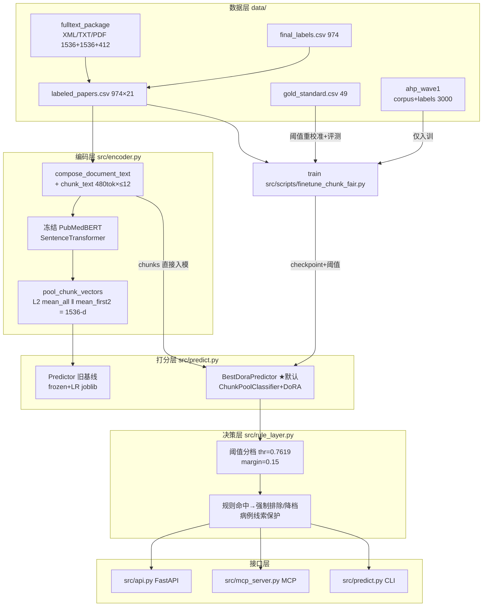

# 架构文档：PubMedBERT 遗传变异病例筛选

面向产前遗传变异**病例报告/病例系列**的文献相关性筛查系统：输入题目/摘要/全文（或 PDF），输出三档决策 `relevant / review / irrelevant`。本文档描述整体架构、算法设计、数据结构与目录结构。用户向说明见根目录 [`README.md`](../README.md)。

---

## 1. 整体架构

### 1.1 分层视图



一次推理的固定顺序：**取文 → 分块 → 编码/池化 → 模型分 `score` → 阈值三档 → 规则层覆写 → 输出 JSON**。规则层只允许降档（`relevant→review→irrelevant`），绝不升档；召回由模型负责，精确率由规则负责。

### 1.2 模块清单（运行时）

| 文件 | 职责 | 关键符号 |
|---|---|---|
| `src/encoder.py` | 分块、冻结编码、1536-d 池化、词表 aux、旧 head 载体 | `load_encoder`, `chunk_text`, `compose_document_text`, `pool_chunk_vectors`, `document_features(_batch)`, `ShippedLogisticHead`, `IdentityScaler` |
| `src/rule_layer.py` | 模型后置规则（无外部依赖，纯正则） | `apply_rules`, `collect_rule_hits`, `RuleHit/RuleResult`, `REVIEW_MARGIN=0.15` |
| `src/predict.py` | 两种后端 + CLI | `BestDoraPredictor`（默认）, `Predictor`（legacy LR）, `load_predictor`, `extract_pdf_text` |
| `src/api.py` | FastAPI 服务（启动加载一次） | `lifespan`, `/health`, `/predict`（JSON / multipart / `pdf_base64`） |
| `src/mcp_server.py` | MCP 工具面 | `get_screener_info`, `screen_paper`, `screen_pdf`, `screen_batch`(≤20)；stdio/sse/streamable-http |
| `src/train.py` | 基线训练：缓存特征 → GroupShuffleSplit → LR → 阈值 | `load_dataset`, `default_subset_mask`, `make_splits`, `select_threshold`, `binary_metrics`, `build_feature_cache` |
| `src/build_dataset.py` | 从 final_labels + 全文包构建 `labeled_papers.csv`（离线、无网络） | `extract_jats_abstract`, PDF 回退, `build_stats.json` |

`BestDoraPredictor` 在运行时反向 import 训练脚本 `src/scripts/finetune_chunk_fair.py`（取 `ChunkPoolClassifier`/`wrap_dora`/`doc_to_chunks` 等），因此 `src/scripts` 必须与根模块同仓同布局；其余 `src/scripts/*.py` 均为训练/评测/审核工具，不在服务路径上。

### 1.3 后端选择逻辑

`load_predictor`（`predict.py:386`）与 `api/mcp_server` 的环境判定一致：

```
MODEL_BACKEND ∈ {best, dora, dora_chunk} 且 artifacts/best/config.json 存在 → BestDoraPredictor
否则（含 --legacy-lr / MODEL_PATH）                                        → Predictor（artifacts/model.joblib）
USE_RULES=0 → 规则层旁路（CLI 等价 --no-rules；MCP 可按调用临时覆盖后复原）
DEVICE 未设 → torch.cuda.is_available() 自动 cuda/cpu
```

冻结的部署配置在 `artifacts/best/config.json`：checkpoint、threshold.json、训练 metrics 均以**仓库根相对路径**记录，由 `ROOT / cfg["paths"][...]` 解析。注意 `config.json:"threshold"`（0.7619357705116272）是舍入快照，运行时实际生效值取 `threshold.json` 的 **0.7619361281394958**（文件缺失才回退）。

---

## 2. 算法设计

### 2.1 长文档编码：分块 + 双通道池化

PubMedBERT 单窗 512 token，病例报告动辄数万字符，直接截断会丢全文证据（消融 B 证明全文对 DoRA 召回 +4.6pt、AP +4.9pt）。方案（`encoder.py`，训练与推理严格同一协议——"fair" 的含义）：

1. `compose_document_text`: `title. abstract` + `\n\n` + `text`；
2. `chunk_text`: tokenizer 编码后按 `chunk_tokens=480` 硬切；超过 `max_chunks=12` 时**保留前 `keep_first=2` 块**（题目+摘要区），其余用 `np.linspace` 均匀抽样补齐，去重保序——全文再长也最多 12 次前向；
3. 每块经冻结 `SentenceTransformer.encode`（mean-pool、L2 归一）得 768-d；
4. `pool_chunk_vectors`: `X = [L2(mean(all chunks)) ‖ L2(mean(first 2))]` → **1536-d**。双通道让线性头同时看到"全文证据"与"题摘门面"；
5. 可选 aux（模式 C）: 病例词密度 + 变异/检测词密度（`CASE_TERMS`/`VARIANT_TEST_TERMS` 每千字命中数）。消融 C 显示几乎无增益，生产用 B。

### 2.2 微调：ChunkPoolClassifier + DoRA

`src/scripts/finetune_chunk_fair.py`（★最优解训练器）把上面协议整个搬进模型内部，端到端可微：

- `ChunkPoolClassifier` = `AutoModel(pubmedbert)` → attention-masked per-chunk mean → `pool_doc`（同 2.1 的 L2 双池化）→ `Linear(1536→2)`；
- batch 内所有文档的 chunk 摊平成一维送入（`collate_examples` 记录 `owners` 归属向量），按 owner 分组池化，规避变长文档的 padding；
- `wrap_dora`: PEFT `LoraConfig(use_dora=True, r=16, α=32, target_modules=["query","value"], dropout=0.05)` 只挂进编码器；分类头全量可训。可训练参数 **611,330 / 110,093,570（0.56%）**；
- 训练超参（`dora/metrics.json.hyper`）：epochs=4、bs=2、grad_accum=4、lr=2e-4、wd=0.01、warmup 6%、AMP、grad clip 1.0、seed=42；类别反比加权 CE；
- 早停：每 epoch 在 val 上以固定 0.5 阈值算 `val AP@0.5`，保留最优 epoch 权重（本运行 best_epoch=2, AP@0.5=0.949）；
- 同脚本 `--method full|galore` 提供对照组（全量 FT + gradient checkpointing；GaLore 低秩梯度投影优化器），金标 49 上 DoRA AP≈0.76 优于两者，故默认 DoRA。

### 2.3 数据与切分协议

- **切分**（`train.make_splits`）：`GroupShuffleSplit` 以 `group_id`(=PMID) 为组，64/16/20，重试至多 60 个 seed 变体（seed=42 起）保证三折都含正负类。同一 split 被 `train.py`、`finetune_chunk_fair.py`、`ablation_abcd.py`、`eval_rule_layer.py` 共享——所有指标可比的前提。
- **默认子集**（`default_subset_mask`）：`weak=False 且 label_source!=model`，974→883 篇；指标一律在子集的 val/test（140/177）上报。
- **入训扩量**：微调 train 折 = 子集 train 566 + **AHP 硬标 2747**（见 2.6）→ n_train=3313；val/test/gold 永不混入弱标。
- **两级阈值**（`train.select_threshold`）：候选点取相邻分数中点，选满足 `recall ≥ 0.95` 且 precision 最大者。
  1. val 上选 `0.8793841302394867`；
  2. 金标 49 重校准为 `0.7619361281394958`（`threshold.json`, `source:"gold_r95"`）。金标此时既是校准集，`gold49_ap_dora=0.762` 应读作校准拟合，test 才是留出。另注意 `rule_layer_metrics.json` 的 `"gold49"` 块实测 n=40（早期导出的 `gold_predictions.csv` 只有 40 行；其余 9 篇仅有分数，见 `gold49_scores_recal.csv` 49 行）。

### 2.4 决策分档 + 规则层（召回保持的精确率增强）

`rule_layer.py`，模型分数之后、输出生成之前：

```
score ≥ t            → relevant
t−0.15 ≤ score < t   → review     （REVIEW_MARGIN=0.15，灰区交人工）
score < t−0.15       → irrelevant
```

规则扫描 `title+abstract`（head）与正文前 12000 字符；`RX_CASE_PROTECT`（case report/proband/de novo variant/trio exome…）命中即 `protected`：

| 组 | 规则码 | 触发 | 动作 |
|---|---|---|---|
| 综述/指南 | REVIEW_OR_GUIDELINE | 题或摘匹配 systematic review/meta-analysis/guideline… | force_irrelevant（摘匹配需未 protected） |
| NIPT/cfDNA | NIPT_SCREENING_COHORT | NIPT ∧ (大队列数字 ∧ 筛查语) | force_irrelevant |
| | NIPT_SCREENING | NIPT ∧ ¬protected | demote_review |
| 大队列筛查 | LARGE_PRENATAL_COHORT / COHORT_LANGUAGE | cohort ∧ scale / 仅 cohort ∧ ¬protected | force / demote |
| GWAS/数据库/预测 | GWAS_DB_OR_PREDICTION | GWAS/polygenic/in-silico/ClinVar curation/ML model… ∧ ¬protected | force_irrelevant |
| 方法工具 | METHOD_TOOL_TITLE | novel assay/pipeline/software… ∧ ¬protected | demote_review |
| design 字段 | DESIGN_HARD_EXCLUDE / DESIGN_SCREENING | design 以 review/method 或 screening/validation 开头 | force_irrelevant |
| 保护降档 | PROTECTED_DEMOTE_ONLY | force 命中但 protected | 仅 relevant→review |

不变式：**规则永不把 irrelevant 升为 relevant**；`force_irrelevant` 优先于 `demote_review`；被病例线索保护时硬排除降级为最多 review。效果（test n=177，pipeline 口径）：Spec(困难负) 0.37→**0.815**，R 1.000→0.977（3 例真阳性被规则牺牲、全部落入复核流），P 0.774→**0.830**，F1 0.872→**0.898**；触发规则 32 处覆写，code 计数见 `artifacts/best/rule_layer_metrics.json`。

### 2.5 PDF 路径

`extract_pdf_text`（PyMuPDF，`import pymupdf` 回退 `fitz`）：逐页 `get_text` → 合并、NUL 清洗；`--pdf`/API multipart/`screen_pdf` 共用。record 带 `pdf_path` 且无 `text` 时按仓库根解析相对路径后自动抽文。API 侧 `MAX_PDF_BYTES`（默认 30MB）超限 413。

### 2.6 AHP 多模型弱标（训练数据生产，`src/scripts/ahp_label/`）

用三个轻量专家模型给 3000 篇新采样文献打弱标，扩大微调训练集：

1. `sample_wave.py`：从 AutomatedPubMed `index.csv` 分层抽 3000（排除已标 974，按年代/期刊桶分层）；
2. `build_corpus.py`：PDF 抽文 → `corpus.jsonl`；
3. `judge_models.py`：claude/gpt/gemini 三专家按 `criteria.py` 的四准则 prompt（FETAL / PHENO_US / GENETIC_TEST / CASE_PRIMARY，JSON schema 回复）打分，逐模型 JSONL 断点缓存；
4. `ahp_core.py`：Saaty **AHP**——幂迭代求判断矩阵主特征向量 → 权重，`CR = CI/RI` 一致性检验（criterion_CR=0.0170 < 0.1 通过；专家矩阵未校准前取均匀 1/3）；
5. `aggregate.py`：`P = Σ w_criterion · score`（缺失回退 qualifies±confidence），硬标阈值 `P≥0.55→1 / P≤0.45→0 / 其余 uncertain` → `labels_ahp.csv`（2026-11-04 快照：1=1595, 0=1152, uncertain=253）；
6. `merge_and_train.py`：硬标并入 LR 基线 train 折复训对照（AHP-LR 表现不及 DoRA，仅存档）。
编排入口 `run_wave.sh`（`--pilot` 先 100 篇试跑）。

### 2.7 金标闭环

`error_audit`/`export_dora_review` 导出 FN/FP 与 review 队列 → `gold_review.py`（FastAPI Web UI 或 `--cli` 终端模式，队列 `fn_fp|test_set|disagree|weak_model|no_gold|all`）逐篇人审 → 追加写 `data/gold_standard.csv`（当前 49 篇：23 正 26 负，reviewer=yangzs）→ 触发阈值重校准（2.3）与 `eval_rule_layer` 复评。金标不参与训练，只做校准/评测，防止泄漏。

### 2.8 主要结果（test=seed42 默认子集 177；pipeline 口径 relevant|review 计召回）

| 系统 | thr | Recall | Precision | F1 | 备注 |
|---|---|---|---|---|---|
| **DoRA + rules（默认）** | 0.762 | **0.977** | **0.830** | **0.898** | 困难负 Spec 0.815；n_relevant/review/irrelevant=133/20/24 |
| DoRA only | 0.762 | 1.000 | 0.774 | 0.872 | 纯模型 AP 0.8847；Spec 0.37 |
| DoRA auto 口径（仅 relevant） | 0.762 | 0.854 | 0.835 | 0.844 | 无人工兜底时的下界 |
| fair head_v3（frozen+LR） | 0.192 | 0.954 | 0.849 | 0.899 | `artifacts/config.json`；gold AP≈0.50，泛化弱 |
| 金标 49（校准集） | 0.762 | 1.000 | 0.581 | 0.735 | DoRA+rules；R/P/F1 实测于其中 40 篇，AP 0.762 为全 49 篇（`gold49_reeval.json`） |

数字出处：`artifacts/best/rule_layer_metrics.json`、`artifacts/finetune_fair/dora/metrics.json`、`artifacts/ablation_abcd/`。硬化证据（bootstrap CI/GroupKFold/阈值策略）见 `artifacts/optimization/`，属上一代 LR 基线。

---

## 3. 数据结构

### 3.1 数据集（`data/`）

`labeled_papers.csv` —— **训练/评测唯一入口**（974 行 × 21 列，27.8MB，字段内含换行）：

| 列 | 语义 |
|---|---|
| `doc_id`, `group_id`, `pmid`, `pmcid` | 同值=PMID 字符串；`group_id` 是切分防泄漏键 |
| `title`, `abstract`, `text`, `year`, `design`, `tests`, `methods` | 正文；`text_source`∈{txt 768, pdf 206}；`abstract_available`, `full_text_available`(974/974), `text_chars`, `abstract_chars` |
| `label`(0/1), `label_source`(claude_round1/round3/round3_fullread/model/curated_gold), `weak`, `confidence`, `label_reason` | 监督标签谱系；"默认子集"用后两列筛 |

`load_dataset` 强校验前 8 列存在、label∈{0,1}，并把 `weak`/`full_text_available` 规范化为布尔。

- `final_labels.csv`：上游标注（974，BOM；含 `reason/quote/prob_v2`），`build_dataset.py` 的输入，勿改。
- `gold_standard.csv`：人审金标 49 × 16 列（`gold_label∈{0,1,?}`、`gold_reason_code/text`、`reviewer`、`prior_*`、`model_score/decision`），append-only。
- `ahp_wave1/`：`sample_3000.csv`(18 列分层元数据)、`corpus.jsonl`（`{pmid,title,text}`，gitignore）、`labels_ahp.csv`（12 列：P/label/majority/p_*/vote_*/reasons）、`ahp_config.json`（准则权重 FETAL .168/PHENO .342/GENETIC .383/CASE .107 + 专家权重 + CR）。
- `fulltext_package/`：`manifest_fulltext.csv`(974×14：PMID…PDF_file/TXT_file/XML_file) + `xml|txt|pdfs/`（gitignore，338MB）。

### 3.2 特征张量

| 载体 | 形状/键 | 生成者 |
|---|---|---|
| 运行时文档特征 | `float32[1536]` = `[mean_all₇₆₈ ‖ mean_first₂₇₆₈]`，各自 L2；模式 C 追加 aux 2 列 → 1538 | `encoder.document_features*` |
| 特征缓存 npz | `artifacts/features/pubmedbert_mc{max_chunks}_ct{chunk_tokens}_n{n}_{fp10}.npz`：键 `doc_ids(U), mean_all(974,768), mean_head, aux(974,2), full_text_available(bool), labels(i64)` + 同名 `.json` sidecar（fingerprint=sha256(参数+doc 长度+前 2000 字符 sha1)，失配自动重编码） | `train.build_feature_cache` |
| 消融缓存 | `artifacts/ablation_abcd/features_A_title_abstract.npz`、`features_B_fulltext.npz`（`X(974,1536)` + `aux` + `encode_sec`） | `src/scripts/ablation_abcd.py` |

### 3.3 模型工件

**DoRA bundle**（`artifacts/finetune_fair/dora/checkpoint/`，440MB，gitignore；`artifacts/best/checkpoint` 是指向它的相对符号链接）：
- `model.pt`：`{"model_state": ChunkPoolClassifier 全 state_dict（含 PEFT 前缀 `encoder.base_model.model.*` + `classifier.*`）, "method": "dora", "model_path": 训练用快照路径}`。加载三步曲（`BestDoraPredictor.__init__`）：`ChunkPoolClassifier(model_path)` → `wrap_dora(r=16,α=32)` 重建结构 → `load_state_dict(state["model_state"], strict=True)`。基座路径来自 `dora/metrics.json:"model_path"`（本机绝对快照路径）经 `resolve_model_path` 探测，不可达时回退 HF id `NeuML/pubmedbert-base-embeddings`；
- `tokenizer.json` + `tokenizer_config.json`：存在 `tokenizer_config.json` 时优先从 checkpoint 加载 tokenizer。

**操作点**（`artifacts/finetune_fair/dora/`）：`threshold.json`（运行时唯一真源：threshold/source/old_val_r95/generated_at）、`threshold_recal_gold.json`（重校准全过程 + 各策略对比）、`metrics_recal_gold.json`。`metrics.json` 即 `created_from.train_metrics`，还含 `history[]`（逐 epoch loss/val AP）。

**冻结部署清单** `artifacts/best/`：`config.json`（§1.3）、`BEST.md`（人读规格）、`threshold.json`/`rule_layer_metrics.json`（字节级副本快照）。

**Legacy LR bundle** `artifacts/model.joblib`（`train.py`/`retrain_head_v3_fair.py --promote` 产出；pickle 引用 `encoder.IdentityScaler`/`encoder.ShippedLogisticHead`，故读它必须先 import `src/`）：

```python
{"model": LogisticRegression(coef_(1,1536), intercept_=-6.898),
 "scaler": IdentityScaler | StandardScaler,
 "threshold": 0.19204701887550127, "threshold_0.5": …, "threshold_balanced": …,
 "encoder_family": "pubmedbert", "feature_mode": "B", "include_aux": False,
 "feature_dim": 1536,
 "encoder": {"model_path": <快照绝对路径>, "max_length": 512, "normalize": True,
             "chunk_tokens": 480, "max_chunks": 12, "keep_first": 2, "pooling": "…"},
 "train_subset": "default train fold only (fair head_v3 retrain)",
 "primary_head", "C", "train_cv_auc", "seed", "target_recall", "recipe"}
```

`casefilter-head-v3`（`pubmedbert/weights/head_v3.npz` = 1×1536 coef + intercept，阈值 0.5，无 scaler）经 `ShippedLogisticHead` 适配进同一 bundle 协议，仅作对照。

### 3.4 输出契约（三入口统一 `predict_record` dict）

```jsonc
{"doc_id", "title",
 "decision": "relevant|review|irrelevant",   // 规则覆写后
 "model_decision": "…",                       // 覆写前（可审计）
 "relevance_score": 0.0-1.0, "threshold", "review_threshold",  // thr−0.15
 "full_text_available", "pdf_used",
 "feature_mode": "dora_chunk_1536" | "A|B|C",
 "encoder_family": "pubmedbert_dora" | "pubmedbert",
 "backend": "dora_chunk",                     // 仅 best 后端
 "rules_enabled", "rules_fired": ["NIPT_SCREENING", …],
 "rules_overridden": bool, "rules_protected_by_case": bool}
```

API：`GET /health`（含 load_error 旁路报告）、`POST /predict`（form/JSON/pdf_base64，422=无任何文本，503=模型未加载）。MCP：单例 predictor + `threading.Lock` 双检懒加载，错误一律以 `{"error":…}` JSON 返回而非抛异常；`screen_batch` ≤20 条。

---

## 4. 目录结构

```
10_genetic-variant-screening/
├── README.md                  # 用户入口：配置摘要、命令、结果
├── requirements.txt           # torch/transformers/peft/galore/fastapi/mcp/…
├── .gitignore                 # 以仓库根为锚（data/fulltext_package、artifacts/**/*.pt|joblib|npz …）
├── command.log                # shell 历史残留（gitignore 命中）
│
├── src/                       # ★ 全部代码（非 package：扁平模块 + sys.path 引导）
│   ├── encoder.py             # 分块/编码/池化/aux/IdentityScaler/ShippedLogisticHead
│   ├── rule_layer.py          # 规则层（纯正则，零依赖）
│   ├── predict.py             # BestDoraPredictor + Predictor + CLI
│   ├── api.py                 # FastAPI（uvicorn --app-dir src api:app）
│   ├── mcp_server.py          # MCP 四工具（stdio 默认）
│   ├── train.py               # 数据协议/切分/阈值/metrics 的规范实现 + LR 基线训练
│   ├── build_dataset.py       # labeled_papers.csv 构建（JATS/PDF 抽取，离线）
│   └── scripts/               # 训练/评测/审核工具；被根模块反向 import 的仅 finetune_chunk_fair
│       ├── finetune_chunk_fair.py      # ★ DoRA/full/galore 公平分块微调（最优解训练器）
│       ├── finetune_pubmedbert.py      # 旧 512 截断微调协议（历史对照）
│       ├── ablation_abcd.py            # 消融 A/B/C/D + 困难负评测
│       ├── eval_rule_layer.py          # 规则层评测 → artifacts/rule_layer/
│       ├── gold_review.py              # 金标审核 UI/CLI → data/gold_standard.csv
│       ├── export_dora_review.py       # DoRA 分数/复核队列导出
│       ├── ahp_label/                  # AHP 弱标流水线（+ run_wave.sh 编排）
│       │   ├── criteria.py  ahp_core.py            # 纯函数库
│       │   ├── sample_wave.py  build_corpus.py
│       │   ├── judge_models.py  ahp_weights.py  aggregate.py
│       │   ├── merge_and_train.py      # AHP 并入 LR 基线复训
│       │   ├── run_wave.sh  README.md
│       ├── compare_pubmedbert{,_weights}.py        # vs SPECTER2 / vs head_v3（历史）
│       ├── export_shipped_bundle.py  retrain_head_v3_fair.py  # head_v3 谱系（历史）
│       ├── retrain_with_gold.py  optimize_pubmedbert.py       # LR 谱系调参（历史）
│       ├── error_audit.py  eval_hardening.py                  # Phase-1 硬化分析（历史）
│       └── review_checks.py  optimization_review_checks.py    # 历史验收检查器（指向旧 README/基线断言，仅存档可运行性）
│
├── docs/                      # ★ 全部文档
│   ├── ARCHITECTURE.md        # 本文：架构/算法/数据结构/目录
│   └── briefs/                # 过程记录：任务书(dsh-*/omp-*)、评审规格、证据、月报
│       ├── PUBMEDBERT_MIGRATION.md  OPTIMIZATION_PLAN.md  *_REVIEW_SPEC.md  *_EVIDENCE.md
│       ├── archive/from-10-hyphen/  # 2026-11-03 合并前原件
│       └── logs/                    # *.log 运行日志（gitignore）
│
├── data/                      # 输入语料与标签（§3.1）
├── artifacts/                 # 全部机器产出（§3.3；结构=各脚本 OUT 常量）
│   ├── best/                  # ★ 冻结部署 bundle + checkpoint 符号链接
│   ├── finetune_fair/{dora,full,galore}/   # 微调权重/阈值/指标/报告
│   ├── features/  *.joblib    # LR 时代缓存与 bundle（gitignore）
│   ├── rule_layer/  ablation_abcd/  optimization/  ahp_wave1/  gold_retrain/
│   ├── head_v3_fair/  optimize_pubmedbert/  compare_pubmedbert/  finetune/  smoke/
│   └── archive_specter2/      # 第一代 SPECTER2 归档（LEGACY_SPECTER2.txt）
│
├── pubmedbert/                # 独立子项目 casefilter（pyproject + src/casefilter + tests/weights）
│                              # 仅 compare_*/export_shipped/retrain_head_v3 经 sys.path 借用其 embed/head_v3
└── .cursor/mcp.json           # Cursor MCP：command=.venv/bin/python, args=src/mcp_server.py
```

### 4.1 路径约定（重组后的硬契约）
1. **仓库根 = cwd**：所有脚本/CLI/服务从仓库根运行（README 与本文所有命令均如此）。
2. **ROOT 推导**：`src/*.py` 用 `Path(__file__).resolve().parents[1]`；`src/scripts/*.py` 用 `parents[2]`；`src/scripts/ahp_label/*.py` 用 `parents[3]`。ROOT 一律指向仓库根，与 `data/`、`artifacts/`、`pubmedbert/` 拼接——`src` 内部布局改动不影响数据路径。
3. **import 机制**：根模块间扁平 import（依赖 cwd 或 `src/` 在 `sys.path`）；`src/scripts/*.py` 头部两行引导 `sys.path.insert(0, ROOT/"src")`（+ 需要兄弟脚本时再插 `ROOT/"src"/"scripts"`）；`pubmedbert/src` 按需单独插入。
4. **`artifacts/best/config.json` 只存仓库根相对路径**；旧 generation 的 `metrics*/config*.json` 里有历史绝对路径（`/home|/data/yangzs/...`），是快照记录，重跑脚本会再生成，不必手改。
5. `.gitignore` 锚点（`data/`、`artifacts/`、`src/**/__pycache__`）均相对仓库根，目录名未变，规则继续生效；`docs/briefs/` 中的历史文档保留迁移前的文字（过程记录不回改）。

### 4.2 环境变量

| 变量 | 默认 | 作用 |
|---|---|---|
| `MODEL_BACKEND` | best | best/dora/dora_chunk → DoRA；其余 → legacy LR |
| `USE_RULES` | 1 | 规则层开关（api/mcp） |
| `MODEL_PATH` | artifacts/model.joblib | legacy bundle 路径 |
| `DEVICE` | 自动 cuda→cpu | api/mcp/预测 |
| `PUBMEDBERT_MODEL_PATH` / `PUBMEDBERT_MODEL` | 本机 HF 快照 | 编码器基座（缺失回退 HF id） |
| `HF_HOME`/`HF_HUB_CACHE`/`TORCH_HOME` | 用户缓存不可写时自动落 `.cache/` | `encoder._configure_hf_cache` 写探测 |
| `HF_HUB_OFFLINE`/`TRANSFORMERS_OFFLINE`/`PUBMEDBERT_LOCAL_FILES_ONLY` | off | 离线模式 |
| `MAX_PDF_BYTES` | 30MB | API 上传上限 |
| `MCP_TRANSPORT`/`MCP_HOST`/`MCP_PORT` | stdio/127.0.0.1/8765 | mcp_server |

### 4.3 快速验证

```bash
cd <repo-root>
.venv/bin/python src/predict.py --best --sample 1          # 冒烟：1 条真实记录端到端
.venv/bin/python src/predict.py --legacy-lr --sample 1     # 旧基线
.venv/bin/python src/scripts/eval_rule_layer.py            # 规则层指标复算（只读 CSV）
MODEL_BACKEND=best .venv/bin/uvicorn --app-dir src api:app --port 8000 --workers 1
```

---

## 5. 已知限制与风险

- **金标仅 49 篇**且当前用作阈值校准集：`gold49_ap=0.762` 偏乐观；持续用 `gold_review.py` 扩充后应重估。
- test 177 篇 / 47 负例，bootstrap 95% CI 宽（上一代估计 recall [0.87,0.96] / precision [0.73,0.86]），小增益别当真。
- 标签谱系大量来自 LLM（claude_round*），金标人审覆盖有限；规则依赖英文模式匹配，非英文/新表述会漏触发（只影响精确率，不影响召回）。
- `model.pt` 440MB、`labeled_papers.csv` 27.8MB、全文包 338MB 均在 gitignore：换机复现需重训或另传权重 + 恢复 `data/fulltext_package/`。
- API/MCP 默认无鉴权，必须单 worker（best 后端推理后整卡显存实测约 1.2GB；CPU 可跑但慢）；`--workers>1` 会复制模型。
- 仅研究用途，**非临床决策工具**；`review` 档必须人工复核。
